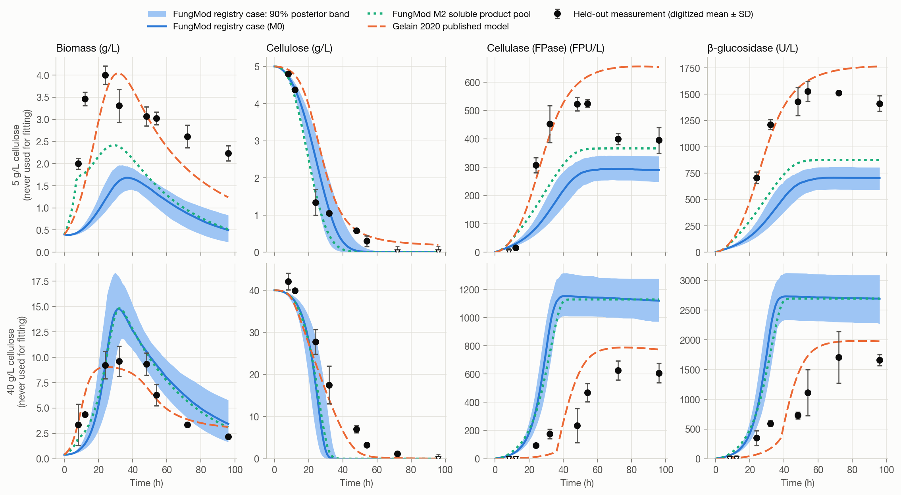
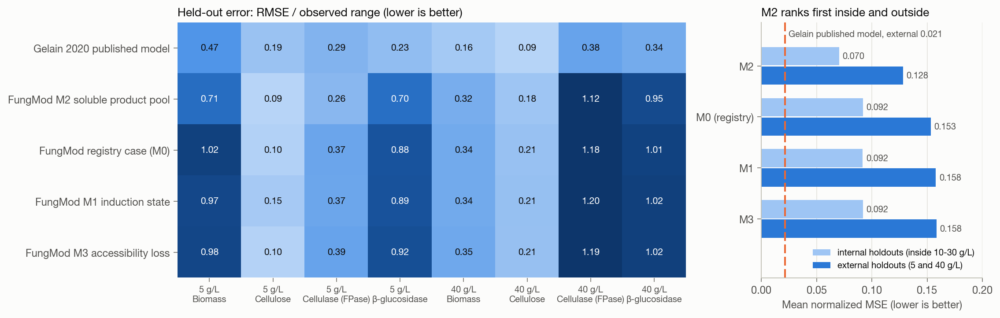
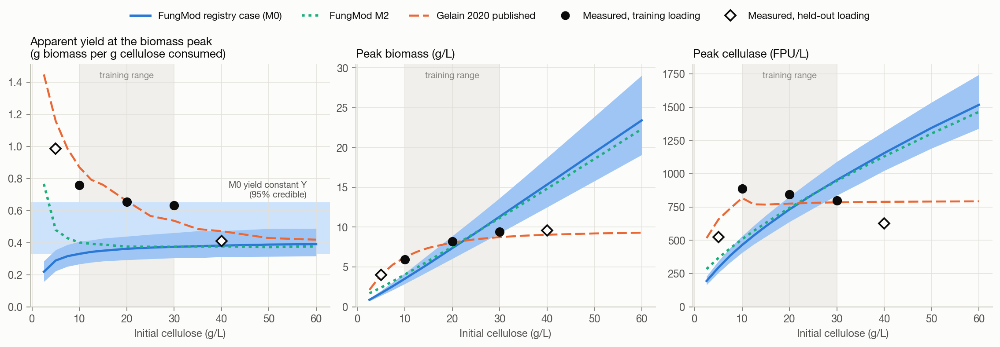

# Held-out loading study

Every FungMod fit of the *Trichoderma harzianum* P49P11 cellulose case used
the Gelain 2020 cultures at 10, 20 and 30 g/L. The article also ran 5 and
40 g/L cultures, plots them in its Figure 3, states that they were not used
for parameter estimation, and leaves them out of the data deposit. This study
digitizes those two cultures and predicts them with five models whose
parameters were frozen before the data entered the repository. Nothing is
fitted to the held-out data.

The study is retrospective: the article and figure were public before any
FungMod fit. It covers one strain in one laboratory with digitized duplicate
means and standard deviations. Agreement or disagreement is evidence about
model structure under these conditions, not validation of a mechanism.

## Data

`scripts/digitize_gelain_2020_figures_2_3.py` reads the raw image streams of
Figures 2 and 3 from the archived article PDF (both checksummed), calibrates
each axis from its tick marks, segments markers by plotting colour, and reads
each error bar (the sample standard deviation of the duplicate cultures) to
its cap. Before writing anything it digitizes Figure 2, whose means are in the
deposit, and refuses to write unless they agree. On the committed run, 92 of
96 deposited points are recovered with a median error of 0.06 percent and a
worst error of 0.70 percent of the axis span; every marker standing on the
zero line is consistent with its deposited value. `--check` regenerates the
files byte for byte.

| File in `data/experiments/literature/gelain_2020_t_harzianum_heldout/` | Content |
| --- | --- |
| `gelain_2020_figure_3_heldout.csv` / `.yml` | 62 held-out observations at 5 and 40 g/L, 41 with a measured SD, 8 left-censored at the zero line |
| `gelain_2020_figure_2_training_with_sd.csv` / `.yml` | The calibration-check digitization of the training cultures, including the SDs the deposit lacks |
| `digitization_calibration.json` | Article and stream digests, per-panel tick fits and the full calibration check |

Two registry environments, `gelain_2020_cellulose_batch_5gl` and
`gelain_2020_cellulose_batch_40gl`, and their initial-loading parameter
records carry the held-out conditions. The nine calibrated constants are
unchanged and remain shared by every condition. Both conditions are modelable
in `scientific` mode; the case template still states its scope as 10 to
30 g/L, so the outputs flag them as extrapolations.

## Models and scores

`fungal_model.research.gelain_heldout` predicts the registry case (`registry_M0`),
the three model-criticism variants with their recorded stage A fits
(`M1_induction_state`, `M2_soluble_product_pool`,
`M3_conversion_dependent_accessibility`) and the authors' published model with
its deposited parameters. A loading without a registry record is a *virtual
condition*: the 10 g/L registry condition rebuilt with only its loading
record overridden.

| Model | Held-out mean normalized MSE | Internal holdouts (criticism stage A) |
| --- | --- | --- |
| Gelain 2020 published | 0.021 | not part of stage A |
| M2 soluble product pool | 0.128 | 0.070 |
| M0 registry case | 0.153 | 0.092 |
| M1 induction state | 0.158 | 0.092 |
| M3 accessibility loss | 0.158 | 0.092 |

The normalization is the stage A one (squared error over the squared
training maximum of each observable). The ranking of the FungMod variants
carries over from the internal holdouts: M2 is best in all eight
observable-and-loading comparisons; M1 and M3 do not improve on M0. The
authors' model, which has empirical ceilings on biomass and enzyme activity
and 20 constants, predicts better than any FungMod variant.





## Diagnosis

The apparent biomass yield at the biomass peak falls from 0.98 g/g at 5 g/L to
0.41 g/g at 40 g/L, and peak biomass levels off near 9.5 g/L at 30 and 40 g/L.
A cellulose-only, constant-yield, mass-closed model cannot reproduce either
end: at 5 g/L it lacks carbon (the medium's peptone and Tween 80 are candidate
sources, not tested here), and at 40 g/L it lacks a ceiling, so it
over-produces biomass, then cellulase, and consumes the cellulose too fast.
Half-degradation times are predicted within about 7 h across 5 to 40 g/L;
90 percent degradation times are underpredicted at every loading, including
the training loadings, because the measured cellulose keeps a slow tail.



A Sobol analysis over the posterior ranges (independent-input approximation)
attributes most of the variance in the 90 percent time to `k_h` and `Kh`;
`Kh` is the constant BAYES-001 bounds from below only.

## Reproduce

```bash
python scripts/digitize_gelain_2020_figures_2_3.py --check --output-dir data/experiments/literature/gelain_2020_t_harzianum_heldout
python scripts/run_showcase_study.py --output outputs/showcase-study
```

The second command (about three minutes, seed 20261009) runs the public
`VirtualExperiment` path for all five conditions, the posterior predictive
bands, the five frozen models, a 13-loading virtual sweep, three Sobol
designs and the BGL1A pH screen, and writes `results.json`, three CSV tables
and nine figures in light and dark variants. `tests/test_gelain_heldout_study.py`
pins the digitizer check, the registry records, virtual-condition parity and
the recorded held-out scores.
